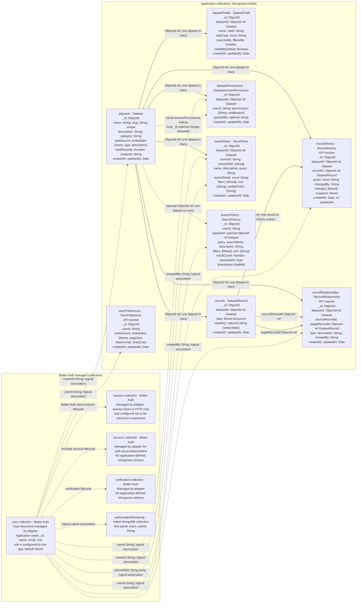

# DataScope Database Model Diagram

DataScope stores application data in MongoDB using Mongoose. The diagram below uses collections as document containers. **Solid arrows** indicate ObjectId references declared in Mongoose schemas. **Dotted arrows** indicate logical associations stored as string IDs and joined by application queries; they are not Mongoose references or database foreign keys.

## Collection guide

### Application data

| Collection / model | What it stores | Relationship details |
|---|---|---|
| `datasets` / `Dataset` | Dataset name, slug, description, category, embedded data-source details, creator ID, and record count. Mongoose adds `createdAt` and `updatedAt`. | `dataSource` is embedded and has no `_id`. `creatorId` is a string association to a Better Auth user. The schema declares a virtual `accessPermissions` lookup from Dataset `_id` to permission `datasetId`. |
| `datasetFields` / `DatasetField` | Per-dataset field name/label/type and flags controlling search, filters, sorting, and default visibility. | `datasetId` is a required ObjectId reference to `Dataset`. A compound unique index prevents duplicate field names within one dataset. |
| `records` / `DatasetRecord` | A record's flexible `data` object, dataset association, optional seed key, and timestamps. | `datasetId` is a required ObjectId reference to `Dataset`. `data` is `Mixed`, so individual record keys are not defined by a fixed Mongoose schema; field metadata is stored separately in `datasetFields`. |
| `datasetPermissions` / `DatasetAccessPermission` | A user's `read` and/or `export` grants for a dataset, and who granted them. | `datasetId` is a required ObjectId reference. `userId` and `grantedBy` are strings, not Mongoose user references. Application logic requires at least one permission. A unique index covers `(datasetId, userId)`. |
| `savedViews` / `SavedView` | A named search configuration, including query mode, filters, sort, visible field names, and sharing list. | `datasetId` is an ObjectId reference. `ownerId` and each `sharedWith` entry are strings. Routes query users to validate recipients and query access grants; those string IDs are not declared Mongoose references. |
| `searchHistory` / `SearchHistory` | A user's search term/mode, filters, sort, description, result count, and search time. | `userId` is a string association. `datasetId` is an optional ObjectId reference to `Dataset` (the route-created history entries require a valid dataset). This schema disables automatic timestamps and instead has `searchedAt`. |
| `recordHistory` / `RecordHistory` | A potential record audit event: action, actor, changes, and optional snapshot. | The schema declares ObjectId references to `Dataset` and `DatasetRecord`; actor `changedBy` is a string. The model is registered and dataset deletion removes its documents, but no active route creates or reads history entries. |
| `recordRelationships` / `RecordRelationship` | A potential typed relationship between a source and target record within a dataset. | Schema references dataset and both record ends by ObjectId; `createdBy` is a string. A unique compound index prevents duplicate `(datasetId, sourceRecordId, targetRecordId, type)` tuples. The model is registered and cleaned up on dataset deletion, but no route currently creates or reads these links. |
| `userPreferences` / `UserPreference` | Embedded theme, page size, date format, and time zone preferences. | `userId` is a string association. A unique index permits one preference document per user ID. The model is registered, but no preferences API currently uses it. |

All listed Mongoose models have MongoDB `_id` values. Schemas with `timestamps: true` get `createdAt` and `updatedAt`; exceptions are called out above. Mongoose indexes provide uniqueness or query support, not relational foreign-key enforcement.

### Better Auth collections

The backend configures Better Auth with `@better-auth/mongo-adapter`, mounts its auth handlers under `/api/auth/*`, and calls Better Auth to validate sessions. The app also queries the adapter's `user` collection directly for administration, role updates, recipient checks, seeding, and first-admin setup. Source code reads user `_id`, `name`, `email`, `role`, and `createdAt` in relevant operations and configures the application `role` field; it does not define full Mongoose schemas for Better Auth collections.

The application configures email/password and Google providers, and customizes session token handling so the token is not returned in response bodies. Better Auth owns the `user`, `session`, `account`, and `verification` document shapes and lifecycle. The repository does not declare full field lists for `account` or `verification`, so the diagram intentionally does not invent them. Better Auth's internal links among users, sessions, accounts, and verification documents are provider-managed, not application Mongoose references shown here.

`authorizationBootstrap` is an additional native MongoDB collection used by the first-admin initializer to claim the single initial-administrator slot. It is not a Mongoose model. The initializer stores a string `userId` in the claim.

## How to read the relationships

- **Solid connectors** are Mongoose schema references. They store MongoDB ObjectIds and make the intended collection link explicit in the schema. They do not make MongoDB enforce a foreign key or automatically cascade deletes.
- **Dotted connectors** are logical associations. For example, permission, saved-view, and history documents store user IDs as strings; application routes look up users or compare those IDs when needed. These links are made by backend code, not by Mongoose `ref` constraints.
- A dataset can have many fields, records, grants, saved views, and history/relationship documents because many documents can store the same dataset ObjectId. Those are one-to-many associations in the application model, not normalized SQL tables with database-enforced foreign keys.
- Record relationships have two separate ObjectId references back to `DatasetRecord`: one for the source and one for the target.

## Why this is a MongoDB document-model diagram

A conventional relational ERD focuses on tables, columns, and foreign keys enforced by the relational database. DataScope instead stores BSON documents in MongoDB collections. Some data is embedded (such as `Dataset.dataSource` and user preference values), record payloads are deliberately flexible `Mixed` objects, and several user links are plain string IDs resolved by application queries. Mongoose `ref` declarations describe references for application use, while MongoDB itself does not enforce referential integrity or automatically cascade changes. This diagram therefore focuses on document shapes and the distinction between declared ObjectId references and logical associations.
