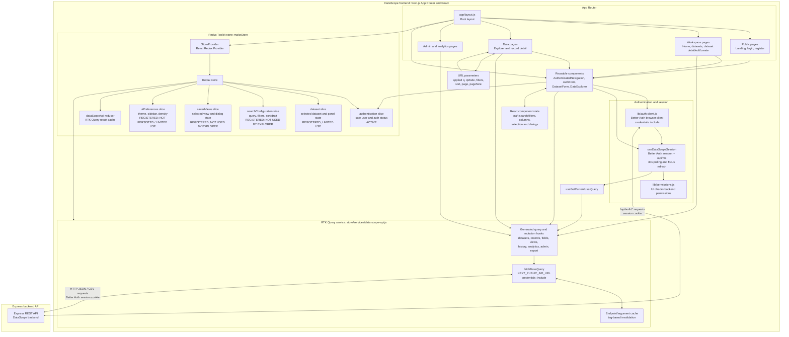

# DataScope Frontend Architecture

## Beginner-friendly walkthrough

### 1. Pages and shared layout

The files under `app/` become the website's routes. `app/layout.js` is the shared outer frame: it installs the Redux provider and renders the authenticated navigation around each page. The pages cover public entry points, the main workspace, dataset management, record exploration, analytics, and administration. Shared forms and the Explorer are implemented as reusable components in `components/`.

### 2. Authentication and session handling

`lib/auth-client.js` creates the Better Auth client pointed at the configured backend URL and includes browser credentials. Login and registration use this client. `useDataScopeSession()` reads the Better Auth session and supplements it with `/api/me`, which provides current role and permission data. That current-user request refreshes every 30 seconds and when the browser regains focus. Navigation and page checks use the returned permissions to decide what to display; the backend still enforces access.

### 3. Redux and the five slices

`StoreProvider` creates one Redux store for the mounted frontend application. `make-store.js` registers five application slices plus RTK Query's cache reducer.

| Slice | What it contains | How the inspected frontend uses it |
|---|---|---|
| `authentication` | Safe user display information and authentication status | Active: navigation syncs the user and clears the API cache on logout/session loss. |
| `dataset` | Selected dataset ID and records-panel state | Registered; its actions are not used by the current pages/components inspected. |
| `searchConfiguration` | Draft query, filters, and sort | Registered; the Explorer currently uses URL parameters for applied state and React local state for drafts. |
| `savedViews` | Selected view ID and save-dialog state | Registered; the Explorer uses RTK Query and local component state for its saved-view interactions. |
| `uiPreferences` | Theme, sidebar collapsed state, display density | Registered; values are not persisted by the backend and have limited/no use in the inspected UI. |

“Registered” means the reducer is connected to the store; it does not mean every screen uses that slice. The API cache is a separate RTK Query reducer, not a sixth application slice.

### 4. API service and cache

`store/services/data-scope-api.js` defines the backend requests and exports generated hooks for pages/components to call. RTK Query stores fetched responses by endpoint and arguments. The service defines cache tags so successful mutations can invalidate related results and cause active queries to refresh. Requests use the API base URL from `NEXT_PUBLIC_API_URL` and include credentials for session cookies.

### 5. How a request reaches the backend

For example, when the dataset Explorer loads, it calls hooks for the dataset, fields, records, saved views, and search history. The hook asks RTK Query to fetch or reuse its cached result. RTK Query sends the HTTP request to the Express API with the session cookie. The backend returns JSON (or a CSV response for export), and the query result becomes available to the component through the hook. The frontend does not connect directly to MongoDB.

### 6. Explorer state

Applied search settings—query text and mode, filters, sorting, page, and page size—are represented in the URL. This lets refresh and browser navigation preserve the current search. Unapplied text/filter drafts, selected rows, visible columns, and other temporary interactions are kept in React component state. The `searchConfiguration` and `savedViews` Redux slices exist in the store but are not the Explorer's active state source.

### 7. Connection boundary

The frontend communicates with the Express backend over HTTP. Better Auth requests use `/api/auth/*`; application data calls use the API paths defined in the RTK Query service. Both include credentials so the browser can send the Better Auth cookie. Session validation, role checks, dataset grants, and database access happen on the backend, outside this frontend diagram's internal state flow.
